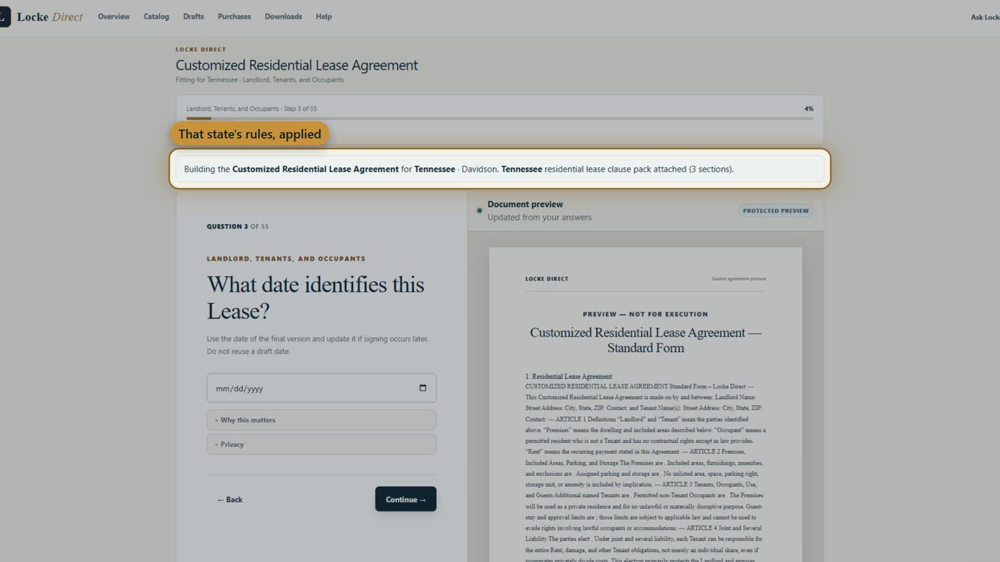

# LOCKE DIRECT
### Legal-document technology that explains, guides and delivers.

**A full-stack product engineering showcase from Locke Development.**  
**Audience:** organizations evaluating a software-development partner, AI integration work, or an engineer who can ship a complete product.

[**VIEW LIVE PRODUCT**](https://www.lockedirect.com/) · [**WATCH DEMONSTRATION**](https://www.lockedirect.com/media/locke-direct-demo.mp4) · [**COMPETITOR ANALYSIS**](COMPARISON.md)

---

## The concept

A user often knows the problem, but not the legal name for the document. Locke Direct begins with that situation. **Ask Locke** directs them toward an available form and helps explain its questions; a guided workflow gathers decisions; deterministic rules assemble and render the final document; the user previews, purchases when applicable, and downloads editable files.

**AI makes the experience understandable. Governed content determines the legal instrument.** That boundary is a deliberate engineering decision, not an incidental limitation.

## Six disciplines demonstrated by a single deployed product

| Discipline | Evidence in Locke Direct |
|---|---|
| **Applied AI engineering** | Two-mode assistant (find a document / help inside a form); catalog allowlisting, constrained structured outputs, user-approved suggestions, controlled fallbacks |
| **Legal-workflow modeling** | State and product-aware rules, field schemas, validations, clauses, conditional schedules, four levels of guided work |
| **Full-stack application development** | React/Next.js + TypeScript experience integrated with server-side APIs, relational data and authenticated sessions |
| **Document generation** | Governed clause assembly, preview and final PDF/DOCX rendering, purchase-linked revisions and downloads |
| **Payments and product operations** | Free entitlements, paid Stripe checkout, signed webhooks, access control and recovery workflows |
| **Privacy-first analytics** | Explicit consent for permitted marketing analytics, exclusion of private form, checkout and assistant content, DNT/GPC considerations |

## Pricing demonstrates intentional product strategy

| Tier | One-time price | Product-design decision |
|---|---:|---|
| **I · Self-Guided** | **FREE** | Keep simple known-fact documents fast; one revision included |
| **II · Customized** | **$14.99** | Ask about terms, include clause choices, check conflicts |
| **III · Advanced** | **$24.99** | Identify missed issues, contingencies and scenarios |
| **IV · Complete Package** | **$49.99** | Understand a party's position and coordinate related documents |

There is no subscription requirement. Paid documents advertise unlimited revisions for 30 days; PDF/DOCX outputs are available under the product's stated scope. Source: [Locke pricing](https://www.lockedirect.com/pricing).

## The competitive story

Locke Direct competes with **LawDepot, eForms, Legal Templates, US Legal Forms and LawDistrict**. Other vendors have advantages in catalog size, mature template libraries, document tools and additional paid services. Locke's defensible pitch is **how its published pricing, progressive guidance, user-controlled AI suggestions and deterministic assembly fit together**.

**[Explore the 15-category side-by-side comparison](COMPARISON.md)** — with explicit leads, ties, source links and claims that remain unproven.

## Ask Locke, explained in six stages

**Describe** a real situation → **Locate** a document that is actually available → **Explain** form questions → **Suggest** allowed answers from supplied facts → **Require approval** before applying → **Hand off** to the separate clause and document engine.

For organizations evaluating practical AI implementation, this demonstrates **human-in-the-loop design**, bounded data transfer and structured integration between LLM output and a deterministic domain application.

[**Inspect the Ask Locke feature review**](ASK-LOCKE.md)

## Watch the real workflow

**[Play the website demo](https://www.lockedirect.com/media/locke-direct-demo.mp4)** · **[Step-by-step guided tour](https://www.lockedirect.com/demo)**

## What clients and employers can take away

This is evidence of designing a coherent commercial SaaS experience across UX, domain logic, APIs, AI integration, security boundaries, payments and deployment. The deliverable is a functioning application—not a collection of isolated proof-of-concept scripts or an AI-generated mockup.

**[Start with the live product](https://www.lockedirect.com/)** · **[Review the source-linked comparison](COMPARISON.md)** · **[Read the methodology](METHODOLOGY.md)**

---

*Locke Direct is not a law firm or a substitute for legal counsel. Legal correctness, jurisdictional coverage and competitor superiority have not been independently benchmarked in this portfolio.*
