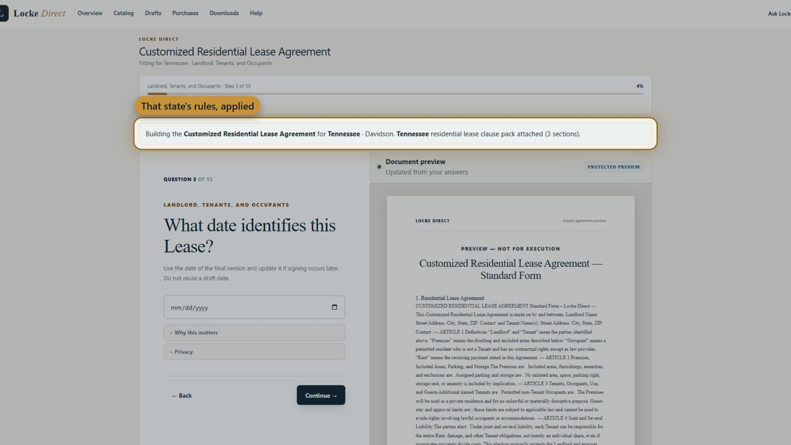

<h1 align="center">LOCKE DIRECT</h1>

<strong>Understand the document. Control the terms. Keep the result.</strong>

<em>Product engineering portfolio by Locke Development.</em>

<a href="https://www.lockedirect.com/">Live product</a> ·
<a href="BROCHURE.md">Portfolio brochure</a> ·
<a href="COMPARISON.md">Competitor comparison</a> ·
<a href="ASK-LOCKE.md">Ask Locke deep dive</a> ·
<a href="DEMO.md">Demonstration</a> ·
<a href="index.html">Visual presentation</a>

---

## More than a legal-template catalog

Locke Direct is an integrated, U.S.-focused legal-document preparation product for individuals and small businesses. A person describes the situation, **Ask Locke** helps select a supported document, structured questions develop the terms, and a governed assembly system produces PDF and editable DOCX documents. The assistant supports the process; **it does not write the final legal clauses by free-form AI generation**.

This public showcase is intended for **future development clients, employers and engineering evaluators** examining delivered software, domain-specific AI integration, production architecture and product design—not just people shopping for a legal form.

### The design decisions that matter

| Demonstrated capability | Engineering and product value |
|---|---|
| **Ask Locke — discover and guide** | Situation-led catalog selection, field explanations, constrained suggestions, explicit user approval |
| **Four guidance levels** | Distinct interview depths for known facts, customized clauses, contingencies and coordinated document packages |
| **Deterministic document assembly** | Maintained content, validated answers and jurisdiction-specific rules kept separate from conversational AI |
| **End-to-end delivery** | Preview, document access, purchase, revision tracking, PDF/DOCX and supported electronic signing |
| **Privacy-conscious analytics** | Consent-first, public-page-only marketing measurement; private document content excluded |
| **SaaS implementation** | Next.js, TypeScript, PostgreSQL, Stripe integration and Railway deployment |

## The official demonstration

**[Play the video](https://www.lockedirect.com/media/locke-direct-demo.mp4)** · **[Open the interactive guided tour](https://www.lockedirect.com/demo)**

The poster is versioned in this public repository; the video is streamed from the live Locke Direct site.

## Four fixed prices, no required subscription

| Level | One-time price | User experience |
|---|---:|---|
| **Self-Guided** | **FREE** | Record known facts; one included revision |
| **Customized** | **$14.99** | Guided term and clause choices |
| **Advanced** | **$24.99** | Identify contingencies and deeper issues |
| **Complete Package** | **$49.99** | Role-aware, coordinated document workflows |

Paid products advertise unlimited revisions for 30 days after purchase. Document availability, execution formalities and signing options vary by product. [Live prices](https://www.lockedirect.com/pricing) · [Current catalog](https://www.lockedirect.com/agreements).

## Why Locke Direct?

**The strength is the combination:** transparent one-time pricing, escalating plain-English guidance, an assistant constrained to real catalog products and form fields, user-approved suggestions, deterministic document generation and a deliberate privacy boundary. Several competitors share individual capabilities; the [five-competitor comparison](COMPARISON.md) distinguishes specific advantages, ties and points not independently established.

**[Read the portfolio brochure](BROCHURE.md)** · **[Explore Ask Locke](ASK-LOCKE.md)** · **[Review methodology](METHODOLOGY.md)**

---

Locke Direct is a document-preparation platform, not a law firm and not a legal-advice service. Claims in this portfolio reflect inspected implementation and published vendor information, not independent verification of legal accuracy across every jurisdiction. Private source code remains private.
